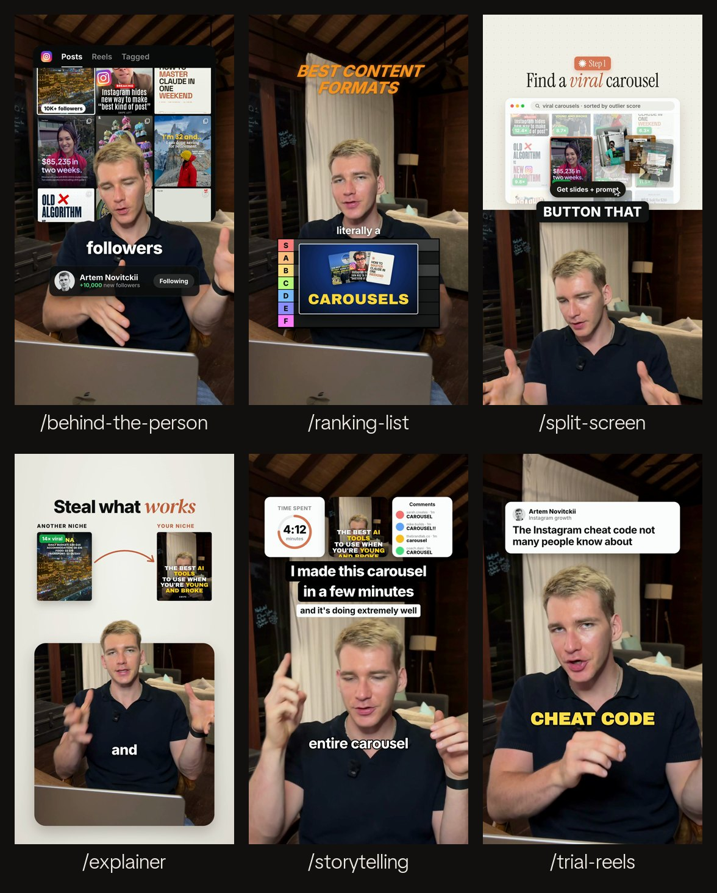

# Claude editing skills

Skills for Claude Code that edit your talking-head clips into finished reels. You type `/explainer` and give it a clip. Claude reads what you say, picks the moment, plans the visuals around your words and renders the reel on your own computer.



| Skill | What it makes |
|---|---|
| `/trial-reels` | The same clip as **3 visually distinct reels** to post as Instagram trial reels: a big title with karaoke captions, a post-card header with punch-in zooms, and a pixel-font stat in a framed shot. |
| `/behind-the-person` | **Graphics behind you.** You are cut out and stand in front of a panel (your post grid, a bar chart or a screenshot). Big words land on your chest and a profile card counts up. |
| `/explainer` | **You at the bottom, visuals on top.** A rounded panel on a light backdrop with your head breaking out over it, and a before-to-after comparison (or a list) explaining the point. |
| `/split-screen` | **The classic half-and-half.** A step badge, a serif headline and a window showing the step on top, you on the bottom, and captions on the seam. |
| `/ranking-list` | **A tier list on your chest.** Each item pops up when you name it and drops into its tier (S to F) on the verdict. |
| `/storytelling` | **Three image cards, a title and a subtitle**, all landing together over one continuous take, with simple TikTok-style captions. |

See them moving: **[novitckii.com/resources/editing-skills](https://novitckii.com/resources/editing-skills/)**

More skills are coming. Pull the repo to get them.

## Install

You need macOS or Linux with **ffmpeg**, **Node.js 18+** and **Python 3.9+**, plus a free **[Groq API key](https://console.groq.com/keys)** for the transcripts.

```bash
brew install ffmpeg node        # if you don't have them
export GROQ_API_KEY=gsk_...     # add it to ~/.zshrc so it sticks
git clone https://github.com/artemnovitckii/claude-editing-skills.git ~/claude-editing-skills
cd ~/claude-editing-skills && ./install.sh
```

`install.sh` links every skill into `~/.claude/skills/` (so they show up as `/trial-reels`, `/explainer` and so on) and runs the one-time setup. The setup:
- makes a Python environment in `kit/.venv`
- fetches GSAP
- warms up HyperFrames
- downloads the matting model

To update later, run `git pull && ./install.sh`.

**Or as a Claude Code plugin.** Run these inside Claude Code:
```
/plugin marketplace add artemnovitckii/claude-editing-skills
/plugin install editing-skills@claude-editing-skills
```
Plugin skills are namespaced (`/editing-skills:explainer`). The first run sets itself up.

## Use

Open Claude Code anywhere and point it at a clip:

```
/explainer ~/Downloads/my-clip.mp4
/trial-reels ~/Downloads/my-reel.mp4 use the hook
/behind-the-person ~/Downloads/clip.mp4, my posts are in ~/Desktop/posts
```

Each skill does the same five things:
1. It transcribes the clip with word timings (Groq Whisper).
2. It picks a stretch and looks at a frame to find your eyes and chin.
3. It writes a small JSON spec next to your clip. Every visual is anchored to a spoken word, so it lands when you say it.
4. It renders with [HyperFrames](https://github.com/heygen-com/hyperframes) (HTML and GSAP to MP4, 1080x1920, 30 fps, your voice kept).
5. It checks a contact sheet with Instagram's safe zones marked, and fixes what's off.

You get `my-clip.explainer.mp4` (and its `.sheet.jpg`) next to the clip. Rendering takes about 15 to 30 seconds per reel. The cutout skills add about 0.1 s per frame for the matting.

Bring your own images (your posts, screenshots, analytics) for the visuals that need them. Every skill also has visuals that need none.

## How it's built

```
skills/<name>/SKILL.md     what Claude follows: steps, the spec, taste rules
skills/<name>/build.py     spec.json -> HyperFrames composition -> mp4
kit/reel.py                shared: clip prep, word anchors, captions, render, checks
kit/transcribe.py          Groq Whisper with word timestamps
kit/cutout.py              speaker cutout (RobustVideoMatting, ONNX on the CPU) -> VP9 alpha webm
kit/setup.sh               one-time setup
```

To add a skill, copy a folder in `skills/` and change its `build.py`. A build is always `Job(spec) -> Comp -> finish()`, and the kit handles clips, words, captions, rendering and the safe-zone sheet. Then run `./install.sh` again.

## Credits

- [HyperFrames](https://github.com/heygen-com/hyperframes) by HeyGen renders the compositions.
- [GSAP](https://gsap.com) drives the animation. It is fetched at setup, not included here.
- [RobustVideoMatting](https://github.com/PeterL1n/RobustVideoMatting) by Shanchuan Lin et al. (GPL-3.0) does the cutout. The model is downloaded at setup, not included here.
- Transcription is Whisper on [Groq](https://groq.com).
- The fonts are Inter, Archivo Black, DM Serif Display, Instrument Serif, Pixelify Sans and TikTok Sans, all under the SIL Open Font License.

Made by [Artem Novitckii](https://novitckii.com). MIT licensed.
