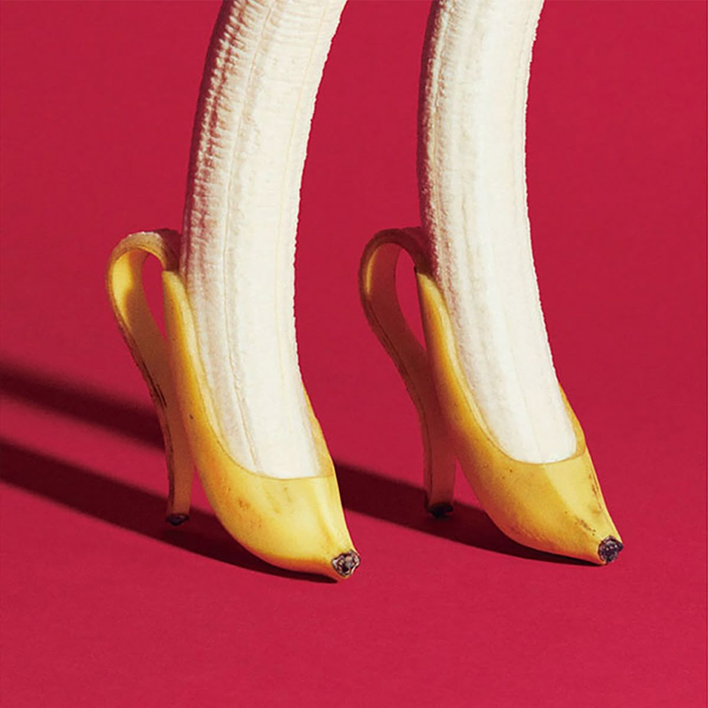
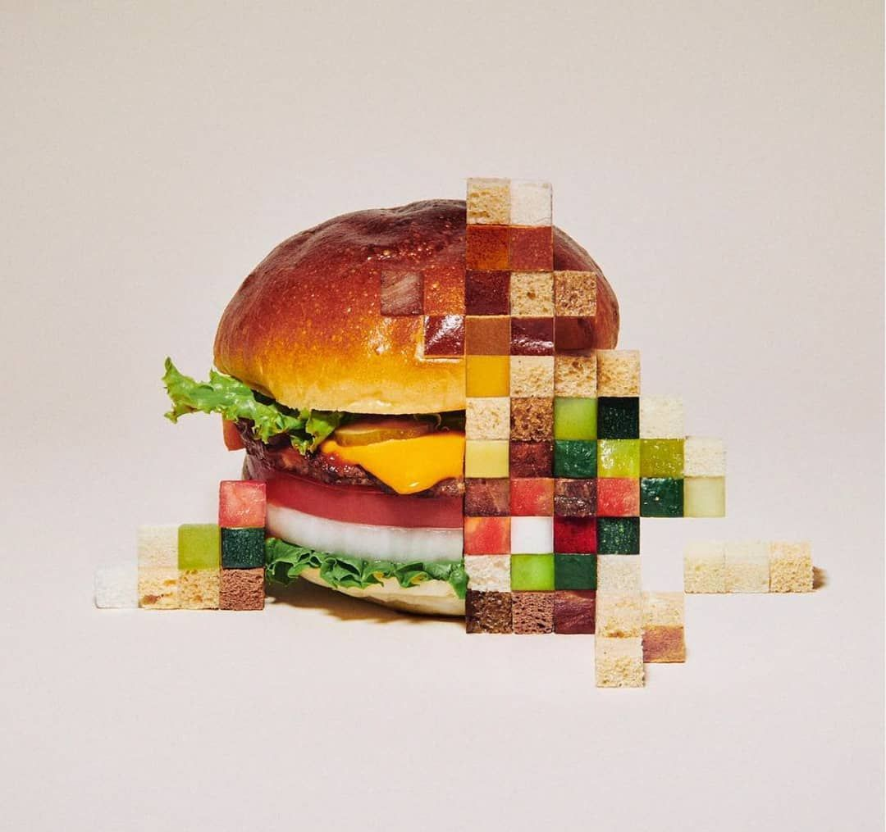
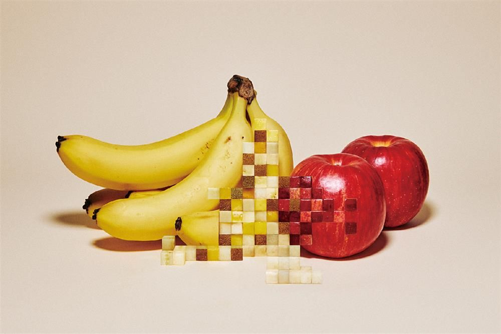
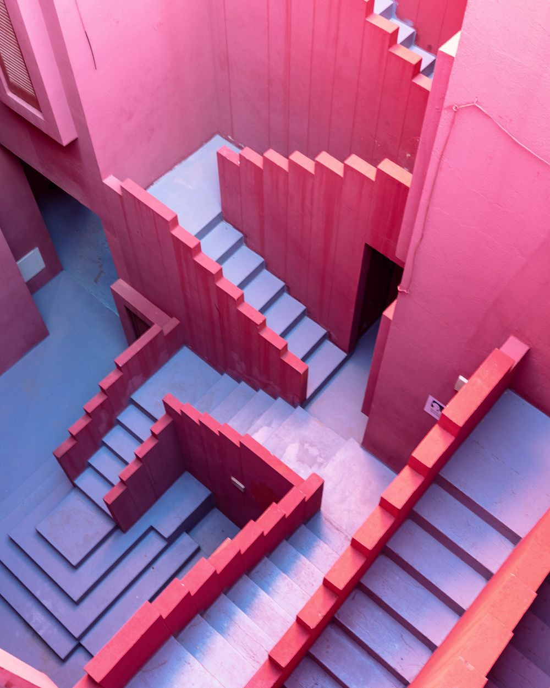
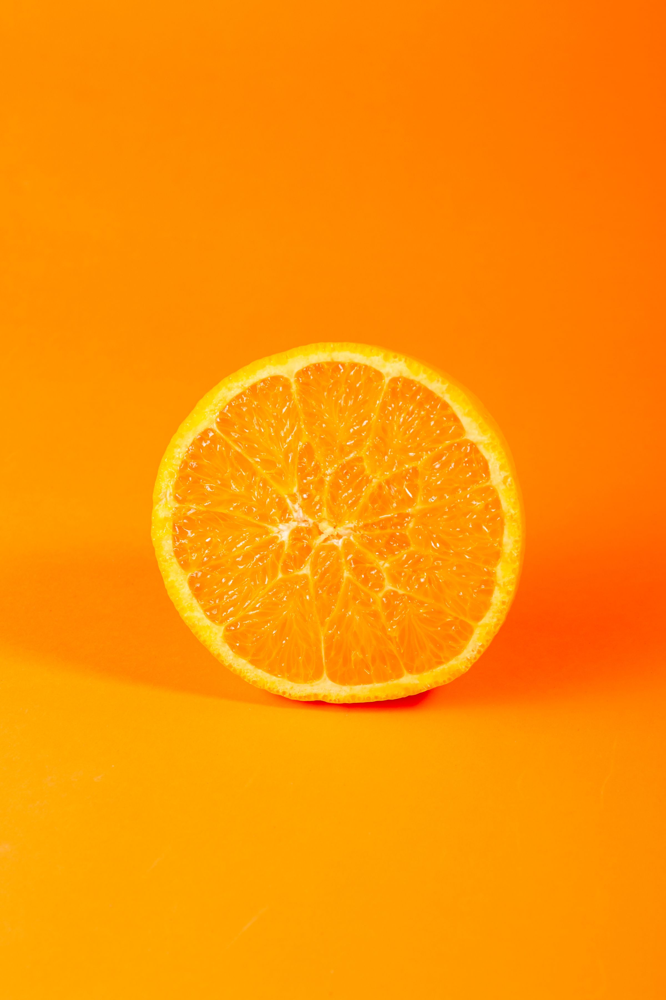
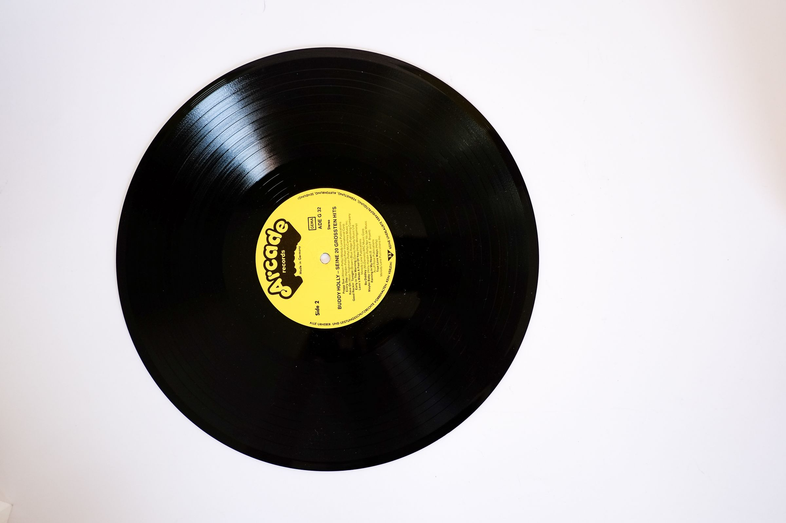
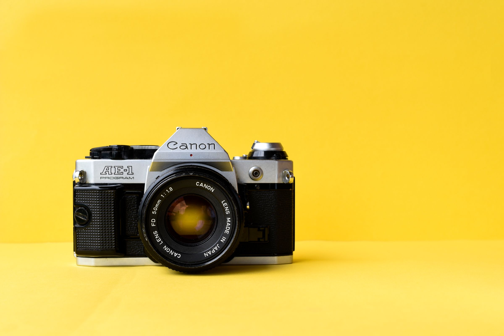

# Showcase image assets

Nine source photographs used by the five editing styles. The files are included at the working resolution used in the reviewed previews; the templates apply their own crops.

| Image | Credit | Source |
|---|---|---|
|  | Yuni Yoshida — Yellow Dancer | [Original source](https://nz.pinterest.com/pin/551550285610662768/) |
|  | Yuni Yoshida — pixelated burger | [Original source](https://nz.pinterest.com/pin/343962490290484672/) |
|  | Yuni Yoshida — pixelated fruit | [Original source](https://nz.pinterest.com/pin/131378514122943808/) |
|  | Jeanette Hägglund — Intersection, La Muralla Roja | [Original source](https://nz.pinterest.com/pin/63191201006223879/) |
|  | Sebastian Weiss — La Muralla Roja | [Original source](https://nz.pinterest.com/pin/517914025904259730/) |
|  | Andrés Gallardo — La Muralla Roja | [Original source](https://nz.pinterest.com/pin/527836018829058282/) |
|  | See source page | [Original source](https://www.pexels.com/photo/fresh-orange-slice-on-vibrant-orange-background-30925637/) |
|  | See source page | [Original source](https://www.pexels.com/photo/retro-phonorecord-with-yellow-label-on-white-background-172843/) |
|  | elif tekkaya | [Original source](https://www.pexels.com/photo/film-camera-on-yellow-background-4523151/) |

## Rights and sample footage

The repository’s MIT license covers its code and authored instructions, not the third-party photographs or previews incorporating them. The six Pinterest-sourced photographs have no redistribution or commercial-use license asserted by this repository; attribution is not a license. The three Pexels sources link to their source pages and license in [sources.json](sources.json). Replace photographs as appropriate for your use.

`explainer.mp4` is Artem’s short portrait demonstration clip with its audio removed. `explainer_cut.webm` is its matched alpha cutout. They are included only to reproduce the examples; do not present the sample speaker as your own footage or imply an endorsement. The preview MP4s in `docs/style-showcase/` inherit the image rights above.
