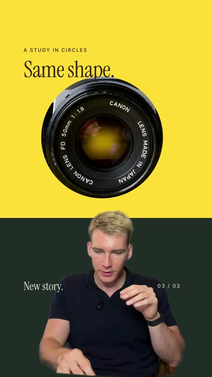
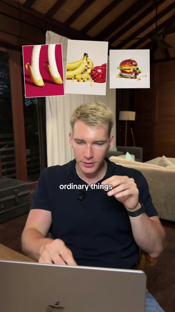
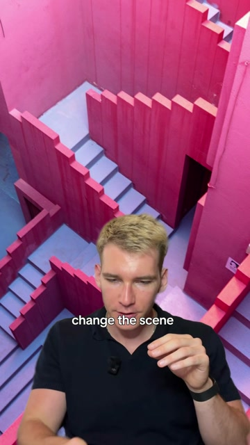
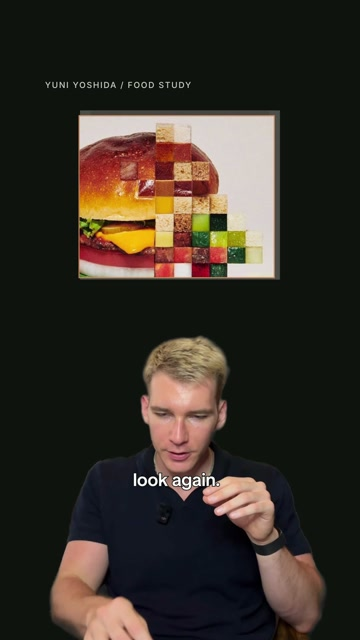
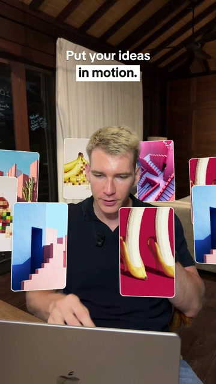

# Five photographic editing styles

The five styles from the showcase: Shape Shift, Picture Stack, Scene Switch, Visual Notes and Orbit Reel. Each includes a runnable 4.2-second template, sharp source images and a silent video preview.

| Shape Shift | Picture Stack | Scene Switch | Visual Notes | Orbit Reel |
|---|---|---|---|---|
| [](shape-shift.mp4) | [](picture-stack.mp4) | [](scene-switch.mp4) | [](visual-notes.mp4) | [](orbit-reel.mp4) |

Click a preview image to open its MP4. All examples use the same supplied speaker clip. [Browse the nine source images and credits](../../assets/style-showcase/README.md).

## Install and reproduce an example

The root `install.sh` discovers all eleven skill folders, including these five. Existing users can run `git pull && ./install.sh` to pick them up. Plugin installs discover the same skill folders.

From the repository root:

```bash
python3 skills/orbit-reel/build.py skills/orbit-reel/example.json
# Editable composition only:
python3 skills/orbit-reel/build.py skills/orbit-reel/example.json --prepare-only
```

Output is `.work/orbit-reel.mp4`, with editable HTML in `.work/orbit-reel.composition/`. The sample renderer needs Python 3.9+, ffmpeg/ffprobe and Node.js 22+/npm; it does not need Groq or transcription. On first use it fetches GSAP 3.15.0 to `kit/vendor/`; HyperFrames 0.8.214 is fetched by npx. To reuse an installed renderer, set `HYPERFRAMES_CLI` to its CLI JavaScript file. The original six skills retain their existing renderer and setup.

## Your footage and images

Supply a 1080x1920 portrait video with at least `media_start + 4.2` seconds. The default offset is 0.04 seconds. Crop deliberately before building: the template cannot track a face or repair an off-center source. Each SKILL.md lists its accepted asset keys. Relative paths resolve from the spec file, including the output path.

Example Orbit Reel spec saved next to your media:

```json
{
  "out": "my-orbit.mp4",
  "media_start": 0.04,
  "assets": {
    "explainer.mp4": "my-portrait.mp4",
    "explainer_cut.webm": "my-portrait-cutout.webm",
    "banana-heels.jpg": "my-first-image.jpg",
    "blue-stairs.jpg": "my-second-image.jpg"
  },
  "text": {"Put your ideas": "Show your work"}
}
```

Unspecified images use the bundled samples. Use photographs appropriate to your topic and inspect every crop after replacement. `text` performs literal HTML substitutions and escapes replacement values. Edit text that changes through GSAP directly in `template.html`.

Shape Shift, Scene Switch and Visual Notes need a cutout. Orbit Reel needs both the original video and matching cutout; replace both together. Picture Stack uses only the original room video. To create a cutout from your prepared portrait source:

```bash
bash kit/setup.sh --cutout
kit/.venv/bin/python kit/cutout.py /path/to/my-portrait.mp4 /path/to/my-portrait-cutout.webm
```

Generate the cutout from the exact same crop, frame rate and duration as the base video. Review hair, hands and depth occlusion. The template builder validates size and duration but cannot establish alpha quality or frame alignment by itself.

## Scope

These are silent 4.2-second style starters, rather than the transcription-driven workflow used by the original six skills. The supplied examples are already rendered. Longer clips, new image anchors, custom captions and audio need an intentional timeline edit. The templates stay editable; they do not automatically recreate an arbitrary reference or segment a speaker during rendering.
